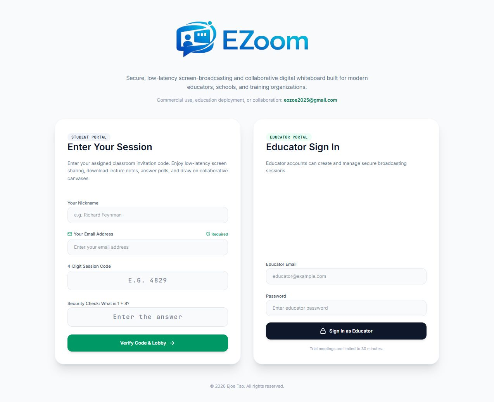
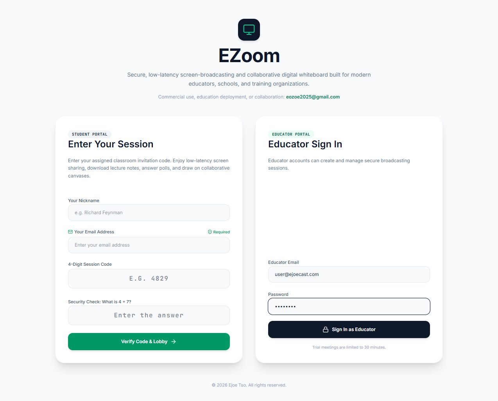
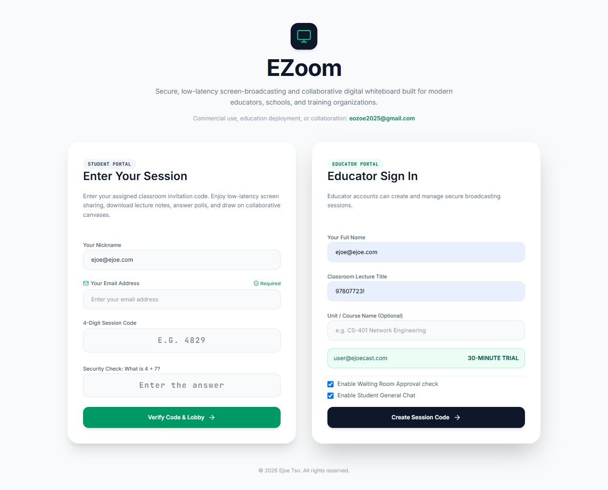
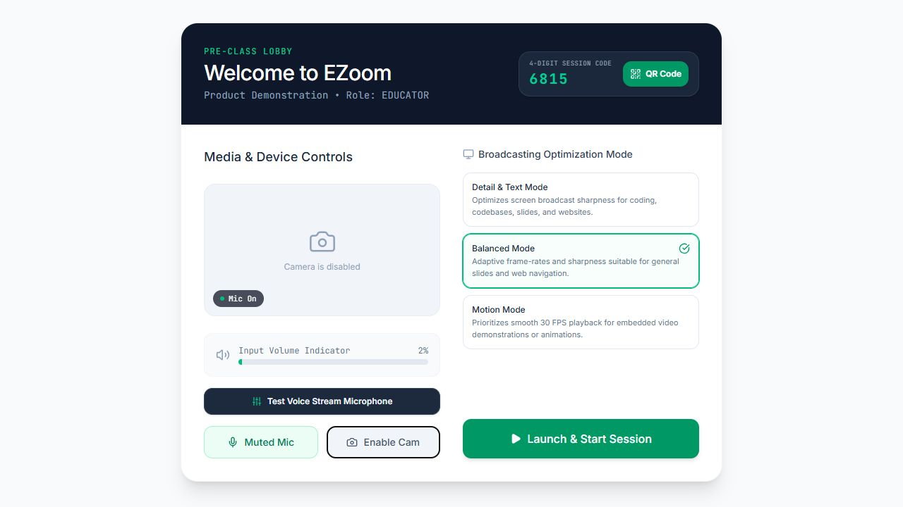
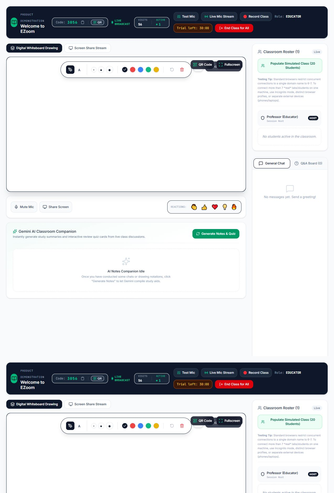
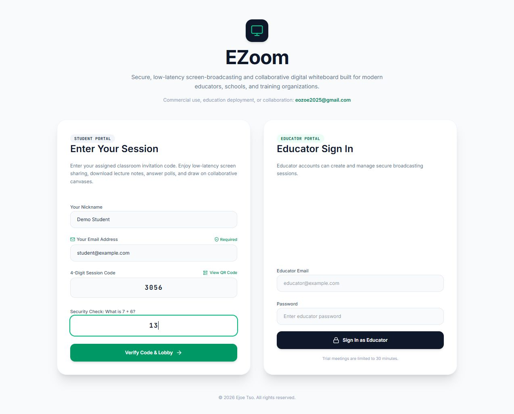
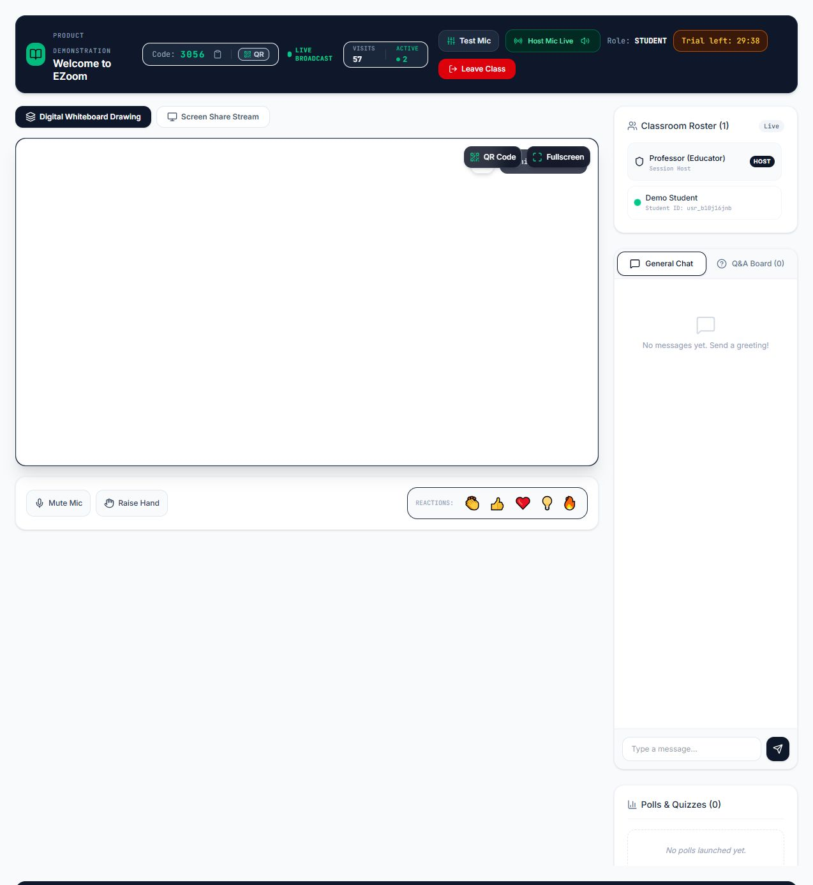

# EZoom visual user guide

This guide walks through a complete EZoom trial meeting. The accompanying [demo video](EZoom-demo.mp4) presents the same workflow as a short visual tour.

## 1. Open EZoom

The landing page separates student entry from educator authentication. Commercial, education, and collaboration enquiries can be sent to **eozoe2025@gmail.com**.

## 2. Create a trial educator account

New educator accounts can host 60-minute meetings. Choose **Create account** in the educator portal, then enter:

- Your name and email address
- A password of at least 12 characters, entered twice

To start a trial meeting:

1. Open EZoom and select **Create account**.
2. Enter your details and select **Create educator account**.
3. Enter your meeting details, then create a session.
4. Check your camera and microphone in the lobby and select **Launch & Start Session**.
5. Share the session code or QR code with students. The meeting ends automatically after 60 minutes.

You can sign out in the educator panel. To delete your account, select **Delete account** and confirm with your password.

## 3. Create a session

Enter an educator display name, meeting title, and optional course name. Choose whether students require waiting-room approval and whether general chat is enabled, then select **Create Session Code**.

## 4. Check devices in the lobby

Confirm that the microphone meter responds and the camera preview is visible. Choose the broadcast quality mode, then select **Launch & Start Session**. Share the four-digit code or QR link with students.

## 5. Teach in the live classroom

The header shows the meeting timer, participant activity, microphone stream, recording, and exit controls. The main workspace provides whiteboard, screen sharing, annotations, chat, Q&A, polls, resources, and AI learning tools. The educator camera can be turned off from its camera panel. Turn on **Live Mic Stream** (or **Turn Mic On** in the stage toolbar) to speak to students. Admitted students can reply by turning on their microphones; their voice is heard by the educator and other participants. The roster's **Mute Student** control stops that student's transmission. Use headphones to reduce echo.

## 6. Join as a student

Students enter their name, email address, four-digit session code, and the answer to the displayed math security question. Scanning the QR code fills the room code automatically.

## 7. Participate in class

After joining or receiving waiting-room approval, students can see the educator camera and shared teaching content, listen to the live educator voice, use chat and Q&A, answer polls, and collaborate on the whiteboard. Enable the microphone in the lobby or tap **Turn Mic On** in the classroom to speak to the educator and class. On iPhone, the bottom **Mic** control remains available from every classroom tab. Tap it again to mute. Allow microphone access when prompted. Browsers may require one click on **Tap to Enable Live Host Voice** before audio playback begins.

## Support

For commercial use, education licensing, custom deployment, or collaboration, email **eozoe2025@gmail.com**.

Copyright © 2026 Ejoe Tso. All rights reserved.
